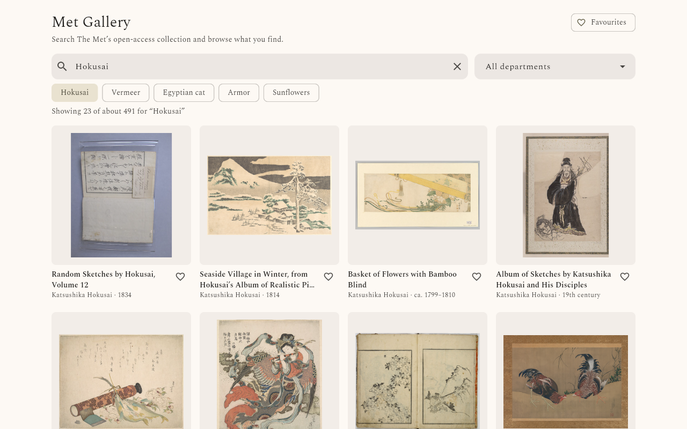

# Met Gallery

The app has a single module, the gallery. You can search for artworks and add them to your favourites, to visit when you actually go to the museum, or just for future reference. I also added a search history, for easy access to your old queries.



## Setup and run

You need Flutter 3.50.x (Dart 3.14). The version is pinned in `.fvmrc`.

```sh
fvm install
fvm flutter pub get
fvm flutter run -d chrome
```

With a plain Flutter install of the same version, drop the `fvm` prefix. For a release build, served locally:

```sh
fvm flutter run -d web-server --web-port 8103 --release
# then open http://localhost:8103
```

The generated files (`*.g.dart`, `*.freezed.dart`) are checked in, so there is nothing to generate. `.env` holds two public URLs and no secrets.

## Track and API

Track 03, Culture Explorer, with the Met Museum Collection API. It is free and needs no key.

The last project I worked on was a social media app, so infinite scrolling and managing images in Flutter are familiar to me. It also seemed like the most challenging of the three tracks, and the limitations of the API made it more interesting.

## Architecture and trade-offs

Riverpod has been my go-to state management at work for the last couple of years, and the service architecture is also what I use in my daily work.

The layers are: widgets, a Riverpod notifier, a service, and a repository that only does HTTP.

The API is rate limited, so I had to put in a pacer and a retry mechanism. While requests wait, I tell the user that we are waiting for the data, and I show skeletons, not spinners. Search only returns ids, so each artwork needs another request to the server, and that's why I am caching all the artworks.

Some numbers:

- The pacer allows 60 requests a minute.
- A failed request is retried up to three times.
- A page is 12 artworks, which costs 13 requests.
- The cache is in memory and holds up to 600 artworks.

## Tests

Every layer has some tests, and I also have some widget tests.

```sh
fvm flutter analyze
fvm flutter test
```

There are 143 tests. They run against fakes, so nothing calls the real API.

## QA

I used Chrome, checked different window sizes by hand, and checked light and dark modes. I went offline, and I tried a search with no results. Checking by hand, I found that the extra images in the artwork dialog could not be scrolled sideways with the mouse, and fixed it.

### Manual test plan

1. Open the app. Skeleton tiles appear, then works by Hokusai.
2. Type `vermeer`. The Network tab shows one search request, not one per letter.
3. Scroll down. A row of skeletons appears and fills.
4. Click a work. The detail opens. Escape closes it.
5. Open a work with several images and drag the row of thumbnails with the mouse.
6. Search `zzqxjv`. "Nothing matches" is shown, with a button back.
7. Set the network to Offline in DevTools and search. An error and "Try again" are shown. Go online and press it.
8. Click the heart under two works, then the Favourites chip. Reload: they are still there.
9. Clear the search field and click in it. Your earlier searches are listed.
10. Resize the window below 600 px. The grid goes to two columns.

## Known limitations

- Only checked in Chrome.
- No screen-reader support.
- Images do not fade in.
- The search is not in the URL.
- The cache is lost on reload.

## With more time

I would add accessibility support for screen readers, and handle images better by fading them in. I could also put the search query in the URL. The search API has other filters that I haven't implemented yet. One other big thing is that the cache is lost on reload; I would move it to more persistent storage like IndexedDB. Going even further, I would create a web service to store the user's information, like favourites and search history, so they can access their own data on multiple devices.

## Time and AI

It took about four hours, give or take. I used Claude Code. First I had to analyse the API, so I created a Bruno collection to check what is really available in it. I then used AI to help me generate the models and to figure out how the rate limiting works. It is actually stricter than the Met's API documentation says. I already had an architecture in mind because I have worked on similar problems before. In short, the output is how I would write the code and architect the project. I went through every single line of it, and I tested every feature by hand.
